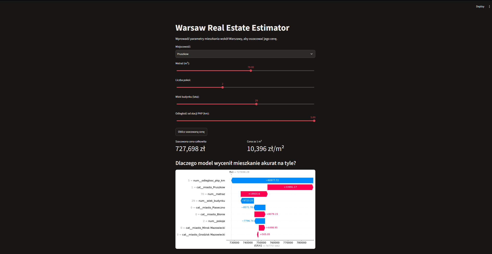

# Warsaw Real Estate Estimator
An end-to-end Machine Learning web application used for the estimated valuation of apartments in towns near Warsaw (Błonie, Grodzisk Mazowiecki, Mińsk Mazowiecki, Piaseczno, Pruszków). 
## Data & Limitations
The dataset used in this project is a synthetic simulation (`generate_data.py`) reflecting realistic real estate dependencies (size, number of rooms, building age, distance to the train station, and city location). 
* A random market noise with a standard deviation of **30,000 PLN** was intentionally added to simulate real-world price fluctuations, which explains the model's Mean Absolute Error (MAE) of around **31,400 PLN**.
## Tech Stack
* `streamlit`
* `pandas` & `numpy`
* `scikit-learn`
* `shap` & `matplotlib`
* `joblib`
## How to Run Locally
1. Install the required libraries:
```bash
pip install -r requirements.txt
streamlit run app.py
```

